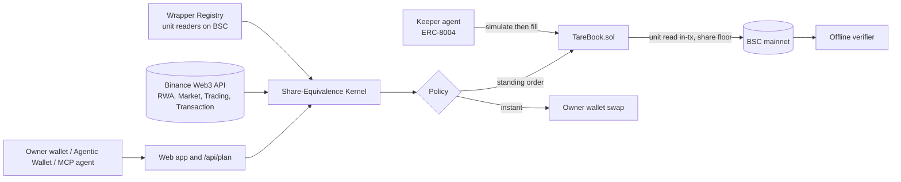

# Architecture

Author: 0xkinno. Spine: **Wrappers quote. Shares decide.**

No price is compared, displayed as a deal, or enforced on-chain in token units. Every comparison and every limit is in underlying shares, converted with a unit factor read from the chain at the moment of use. The agent proposes; deterministic code computes what a share costs; the contract refuses any fill that delivers fewer shares than the owner signed for.

## System



## One fill

```
 quote ──> kernel ──> simulate ──> fill ──> unit read ──> share floor ──> receipt
   │         │            │          │          │               │            │
 routes   rank in     Transaction   anyone    registry reads  shares >=     OrderFilled
 + RWA    shares      API (or       calls     the issuer's    minShares     event with
 status   not tokens  eth_call)     TareBook  own source     else revert   unit + shares
                                              in this tx      ShareFloor
```

## Components

| Path | Role | I/O |
|---|---|---|
| `packages/kernel` | Unit-safe fixed-point math, decomposition, session clock, policy and ranking | none |
| `packages/registry` | Wrapper map built from evidence, on-chain unit readers, direct-pool routing | RPC |
| `packages/binance` | Typed public and signed API clients with typed degraded states | HTTP |
| `packages/verify` | Offline verifier: recomputes a fill from logs and an `eth_call` at the block | RPC |
| `contracts` | `WrapperRegistry`, `TareBook` (buy and sell), fork break suite, deploy script | chain |
| `services/keeper` | Keeper loop, journal, recorder, Telegram notifier, status endpoint | RPC, HTTP |
| `services/agent` | ERC-8004 identity and ERC-8183 certificate job through the BNBAgent SDK | RPC |
| `apps/web` | Next.js app, API routes, MCP server, A2A card, x402 certificate endpoint | HTTP |
| `skills/tare` | Agentic Wallet skill | CLI |

## Unit mechanisms (measured, see DISCOVERY.md)

| Issuer | Where the unit lives | Read in the contract |
|---|---|---|
| bStocks | the token (ERC-8056 scaled UI amount) | `uiMultiplier()` |
| Ondo | `SyntheticSharesOracle` | `getSValue(token)` returns `(sValue, paused)` |
| xStocks | the token (rebasing balance, fee-bearing multiplier) | balance is already in share units |

## Trust boundaries

- The **contract** trusts only the owner-curated registry and the issuer unit sources it reads in the fill transaction.
- The **keeper** is untrusted by the contract: anyone may fill; the worst a keeper can do is nothing.
- The **web app** never signs and never holds a key. `/api/plan` returns calls; the wallet previews and signs them.
- The **model** (optional, wording only) cannot change a decision.
