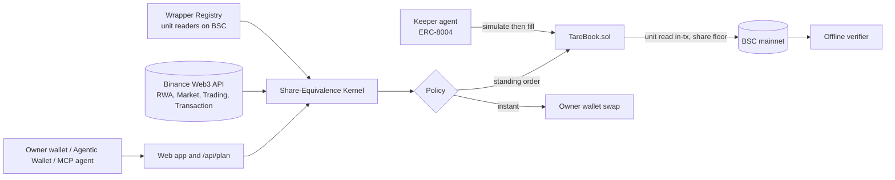
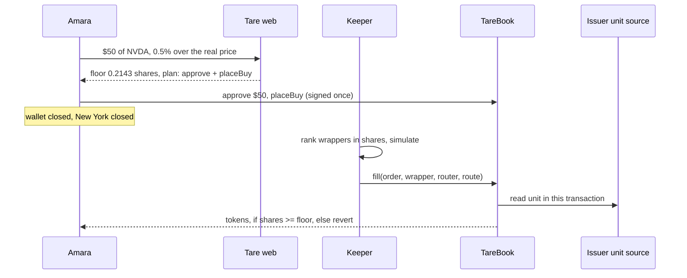

<p align="center">
  
</p>

<h1 align="center">Tare</h1>

<p align="center"><b>The real price of a tokenized stock, net of the wrapper.</b></p>

<p align="center">
  <a href="{{origin}}"></a>
  <a href="https://bscscan.com/address/{{book}}#code"></a>
  <a href="{{origin}}/api/agent/keeper"></a>
  
  
  
  
</p>

**Tare lets first-time on-chain investors set a standing order for a US stock once, in real shares, and have it filled at any hour of the week without handing over their keys, because the chain itself refuses any fill that gives them fewer shares than they signed for.**

<p align="center"></p>

<p align="center">
  <a href="{{origin}}"><b>Open the app</b></a> ·
  <a href="{{origin}}/judge"><b>Judge path (2 minutes, no wallet)</b></a> ·
  <a href="{{origin}}/proof">Proof</a> ·
  <a href="DX_REPORT.md">Developer experience report</a> ·
  <a href="DISCOVERY.md">Discovery</a> ·
  <a href="skills/tare/SKILL.md">Agentic Wallet skill</a>
</p>

---

## Contents

[Try it in a minute](#try-it-in-a-minute) · [Why this exists](#why-this-exists) · [How it works](#how-it-works) · [What it feels like](#what-it-feels-like) · [Tare never holds your keys](#tare-never-holds-your-keys) · [What we measured](#what-we-measured-on-bsc) · [Proof on mainnet](#proof-on-mainnet) · [The guarantee](#the-guarantee) · [Architecture](#architecture) · [The numbers](#the-numbers) · [Binance Web3 API usage](#how-the-binance-web3-api-is-used) · [Agents](#agents-agentic-wallet-mcp-a2a-and-bnb-agent-studio) · [Real and not real](#what-is-real-and-what-is-not) · [Developer experience](#developer-experience-report) · [FAQ](#faq) · [Run it](#run-it) · [Deploy](#deploy) · [Repository map](#repository-map)

## Try it in a minute

1. **Open [the judge path]({{origin}}/judge).** No wallet. A live shelf, then every retained mainnet transaction, each with its BscScan link and a verifier button.
2. **Open a ticker, for example [NVDA]({{origin}}/app/t/NVDA).** Three wrappers weighed in shares, the session, the chart, and what a dollar buys in each.
3. **Connect a wallet and choose *Standing buy*.** Say how many dollars and how far over the real price you will go. You sign one approval and one order.
4. **Close the tab.** A keeper watches the order at every hour. When it fills, the [Orders page]({{origin}}/app/orders) writes a plain sentence per event, and Telegram can tell you.
5. **Check the work.** Paste the order id into [Verify]({{origin}}/verify): the fill is recomputed from chain logs with no vendor API and no model.

## Why this exists

Amara, 29, saves in USDT because her naira savings lose value, and she cannot open a US brokerage. She wants a little Nvidia every month. She is not a trader.

On BNB Chain she finds **three tokens called Nvidia** from three issuers. She then runs into four traps that no price chart shows:

| Trap | What is actually happening |
|---|---|
| **One ticker, three units** | One token is not one share. It is {{units.maxUnitPct}} percent more than a share at most today, and two tokens of the same ticker differ by up to {{units.maxOndoVsBstocksBps}} bps from unit alone, before any premium exists. It moves with every dividend and split, and without a transfer event. |
| **A reference that is not a second opinion** | {{reference.bstocksWithoutStockPrice}} of {{reference.bstocksTotal}} bStocks have no equity reference in the public response; for Ondo the "reference" is the same feed multiplied by the unit. |
| **The clock stops** | The regular New York session covers only {{regularSharePct}} percent of the week, and the weekend alone is {{weekendSharePct}} percent. Tokens keep trading against a reference that is hours or days old. |
| **Quotes break** | {{brokenTotal}} of {{brokenObservations}} recorded quotes were more than five percent from the equity reference. |

Every product that buys for her either asks her to sign each trade, or takes her money into a vault. Tare is a third answer: **a bank standing order crossed with a limit order, counted in shares, enforced by BNB Chain instead of by a company she has to trust.**

## How it works

```
 1  You say        "$50 of NVDA, never more than 0.5% over the real price"
 2  Tare computes  a floor in shares from the live unit and reference
 3  You sign once  approve exactly $50 + place the order (your USDT stays in your wallet)
 4  A keeper acts  any hour: reads every wrapper, ranks in shares, simulates, then calls fill()
 5  The chain      reads the issuer's unit in the same transaction and reverts below your floor
 6  You get        the tokens, the shares, and a line in your order diary
```

The agent decides **when** to buy. The contract decides, in shares, **whether it may**.

## What it feels like

<table>
  <tr>
    <td width="50%"><br><b>The weighing.</b> Three wrappers, one share. The green glow marks the one that delivers the most.</td>
    <td width="50%"><br><b>The judge path.</b> Every retained record links to BscScan and to the verifier.</td>
  </tr>
  <tr>
    <td width="50%"><br><b>The keeper.</b> Passes, fills and refusals by typed reason, read from its own endpoint.</td>
    <td width="50%"><br><b>The proof.</b> Each claim: status, the command that reproduces it, and what it does not show.</td>
  </tr>
</table>

- **It keeps the market's clock.** The paper edition while New York trades; a night edition while it is closed. A header line says how long the reference has been stale.
- **It writes a diary, not a log.** "Fri 21:04 UTC. Waiting: the price was above the limit. Sat 09:12 UTC. Filled: 0.2143 NVDA shares as NVDAB."
- **It says no in words.** A refusal is a typed reason shown verbatim: price above limit, issuer paused, no contract route, broken quote, simulation failed, data source unreachable.
- **It shows degraded states.** "The data source did not answer" is never rendered as "no wrapper".

## Tare never holds your keys

| | |
|---|---|
| **Funds** | Stay in your wallet until the fill transaction. You approve the exact amount of one order; the contract resets it to zero after the call. The book holds nothing between transactions. |
| **Keys** | The web app never signs and holds no key. `/api/plan` returns calls; your wallet previews and signs. The keeper key is a separate hot wallet funded with gas only. |
| **Keeper** | Untrusted by the contract. Anyone may call `fill`. The worst a keeper can do is nothing. |
| **Unit** | Read on-chain in the fill transaction. `fill` has no unit argument to forge. |
| **Admin** | The registry owner curates wrappers and routers. There is no withdrawal, no upgrade path, and no way to touch funds. |

## What we measured on BSC

Everything below is regenerated from files by `pnpm discover`. The full write-up, with raw evidence, is [`DISCOVERY.md`](DISCOVERY.md).

| Finding | Value |
|---|---|
| Wrappers measured | {{discovery.wrappers}} over {{discovery.tickers}} tickers, all three issuers each |
| The unit mechanism differs by issuer | bStocks: `uiMultiplier()` on the token. Ondo: `getSValue()` on a separate oracle. xStocks: rebasing balance with a fee-bearing multiplier |
| API multiplier equals the chain for bStocks and Ondo, not for xStocks | xStocks differ on {{apiVsChain.xstocksMismatch}} of {{apiVsChain.xstocksTotal}} |
| Median deepest pool | bStocks {{liquidity.BSTOCKS.medianDeepestPoolUsd}} USD, Ondo {{liquidity.ONDO.medianDeepestPoolUsd}} USD, xStocks {{liquidity.XSTOCKS.medianDeepestPoolUsd}} USD |
| Contracts can receive the wrappers | {{contractReceive.allOk}} of {{contractReceive.tested}} transfer simulations accepted |
| The aggregator with a contract as taker | SWAP calldata for bStocks and Ondo; xStocks return no liquidity; Ondo has a 5 USD minimum |
| Session basis (Ondo vs bStocks per share, hourly, median absolute bps) | weekend {{backfill.WEEKEND.medianAbsBps}}, regular {{backfill.REGULAR.medianAbsBps}} |

## Proof on mainnet

Real transactions on BNB Smart Chain, cents in size, recorded in [`EVIDENCE.md`](EVIDENCE.md) and verifiable with `pnpm tare verify`.

| What happened | Transaction |
|---|---|
| Standing buy, filled by the keeper while the owner wallet was untouched and New York was closed | [{{ev.buy0}}](https://bscscan.com/tx/{{ev.buy0}}) |
| Second standing buy, same run | [{{ev.buy1}}](https://bscscan.com/tx/{{ev.buy1}}) |
| Standing sell, filled above its USDT-per-share floor | [{{ev.sell}}](https://bscscan.com/tx/{{ev.sell}}) |
| Deliberate refusal: the keeper declined, and a manual fill reverted on-chain with `ShareFloor` | [{{ev.refusal}}](https://bscscan.com/tx/{{ev.refusal}}) |
| An order placed from the web app and filled by the keeper through the aggregator route | [{{ev.aggregator}}](https://bscscan.com/tx/{{ev.aggregator}}) |
| An order placed from the Binance Agentic Wallet (`baw` preview, then execute) and filled by the keeper | [{{agentic.placeBuyTx}}](https://bscscan.com/tx/{{agentic.placeBuyTx}}) |
| A cancel (funds never left the wallet) | [{{ev.cancel}}](https://bscscan.com/tx/{{ev.cancel}}) |
| Keeper identity (ERC-8004 agent #{{agentId}}) | [{{ev.identity}}](https://bscscan.com/tx/{{ev.identity}}) |
| Certificate job (ERC-8183 job {{ev.job}}, state {{job.status}}) | [`evidence/mainnet/erc8183_job.json`](evidence/mainnet/erc8183_job.json) |

| Autonomy run | |
|---|---|
| Orders placed (two buys, one sell) | {{autonomy.ordersPlaced}} |
| Fills made by the keeper | {{autonomy.fills}} |
| Fills with no owner transaction in between | {{autonomy.ownerOfflineFills}} |
| Fills while New York was closed | {{autonomy.fillsWhileNewYorkClosed}} |
| Seconds from placing to the first fill | {{autonomy.firstFillSecondsAfterPlacing}} |

The verifier passes every invariant on each fill (`evidence/mainnet/verify_order_*.txt`).

## The guarantee

> **Wrappers quote. Shares decide.**
> No price is compared, displayed as a deal, or enforced on-chain in token units. Every comparison and every limit is in underlying shares, converted with a unit factor read from the chain at the moment of use.

Twelve named invariants, each checked twice, in [`INVARIANTS.md`](INVARIANTS.md). The ones that carry the product:

| ID | Invariant | Test |
|---|---|---|
| T2 | A buy never delivers fewer shares than signed | `test_shareFloorRevert` |
| T2b | A sell never pays less than the signed USDT per share | `test_sellFloorRevert` |
| T3 | The unit is read on-chain in the fill transaction | `test_keeperCannotPassUnit` |
| T4 | No fill while the issuer has paused the token | `test_corporatePauseBStock`, `test_corporatePauseOndoOracle` |
| T6 | The book holds nothing between transactions | `testFuzz_noResidual`, `invariant_bookHoldsNothing` |
| T7 | Output reaches the owner only | `test_maliciousRecipient` |
| T8 | An order fills at most once | `test_replay` |

**The named failure mode.** A limit written in tokens is filled wrongly after a unit change. `test_unitJump` writes the bStocks multiplier on a mainnet fork: the token-denominated baseline still fills, the share-denominated order reverts with `ShareFloor`.

## Architecture



```
 quote ──> kernel ──> simulate ──> fill ──> unit read ──> share floor ──> receipt
   │         │            │          │          │               │            │
 routes   rank in     Transaction   anyone    registry reads  shares >=     OrderFilled
 + RWA    shares      API (or       calls     the issuer's    minShares     event with
 status   not tokens  eth_call)     TareBook  own source     else revert   unit + shares
```



Details: [`ARCHITECTURE.md`](ARCHITECTURE.md).

## The numbers

Generated from `data/**/summary.json` by `scripts/render_docs.ts`; the full tables are in [`PROOF.md`](PROOF.md).

### Counterfactual: shares per $50

| Arm | Mean shares | Median shares |
|---|---:|---:|
| Naive (lowest token price) | {{counter.arms.naive.meanShares}} | {{counter.arms.naive.medianShares}} |
| Random wrapper (control) | {{counter.arms.random.meanShares}} | {{counter.arms.random.medianShares}} |
| Tare (most shares) | {{counter.arms.tare.meanShares}} | {{counter.arms.tare.medianShares}} |

Tare minus random: {{counter.tareMinusRandomBps}} bps. Tare minus naive on direct pools: {{counter.tareMinusNaiveBps}} bps. With the aggregator the two picks differ in {{agg.differs}} of {{agg.groups}} ticker-size groups, by {{agg.meanTareOverNaiveBps}} bps on average and {{agg.maxTareOverNaiveBps}} bps at most. **The pick matters less than the guarantee, and the files say so.**

### Tests

| Suite | Result |
|---|---|
| Contracts on a BSC mainnet fork (break suite, fuzz, invariants, deploy) | {{forge.passed}} passed, {{forge.failed}} failed |
| Kernel, registry, client, verifier, keeper | {{unitTests}} passed |
| Browser matrix (nine viewports, nine pages, accessibility) and the connected-wallet journey | [`apps/web/e2e`](apps/web/e2e) |

## How the Binance Web3 API is used

| Module | Use in Tare |
|---|---|
| RWA Data | Catalogue by provider type, per-token price, multiplier, equity reference and status, market session, company profile |
| Market | Hourly and daily candles for the weighing chart and the weekend calibration |
| Trading | Aggregated quotes and swap calldata with the book as taker; fills through it were executed on mainnet |
| Transaction | Simulation before send; the keeper falls back to `eth_call` and records which source it used |
| Wallet | Holdings in shares |
| B402 | The paid certificate endpoint; one payment settled on mainnet |

The combination that looks like it should not work but does: **the RWA reference, the on-chain unit factor, a Trading API quote and a simulation, ranked in shares** and enforced by a contract that re-reads the unit.

## Agents: Agentic Wallet, MCP, A2A and BNB Agent Studio

| Surface | What is there |
|---|---|
| **Agentic Wallet / Wallet Skills** | [`skills/tare/SKILL.md`](skills/tare/SKILL.md): "set a standing order", "sell if it reaches", "what did my orders do". The skill calls `/api/plan`; the wallet previews and signs. Mainnet run and findings in [`docs/spikes/agentic-wallet.md`](docs/spikes/agentic-wallet.md). |
| **MCP** | {{origin}}/api/mcp: `tare_shelf`, `tare_decompose`, `tare_best_route`, `tare_verify_fill`, `tare_session`. Read-only, no URL inputs. |
| **A2A** | {{origin}}/.well-known/agent-card.json |
| **ERC-8004 identity** | Keeper registered as agent #{{agentId}} on BSC mainnet |
| **ERC-8183 commerce** | Job {{ev.job}}: a decomposition certificate, submitted at price zero, settles after the policy dispute window |
| **x402 / B402** | `/api/certificate` returns `402` with requirements; a payment settled on mainnet: [`{{b402tx}}`](https://bscscan.com/tx/{{b402tx}}) |

## What is real and what is not

| Thing | Status |
|---|---|
| Contracts on BSC mainnet, verified on BscScan | Real |
| Keeper fills, refusals and cancel on mainnet | Real, cents in size |
| Verifier PASS on every filled order | Real, outputs in `evidence/mainnet` |
| Web app, MCP, A2A, judge path | Real, deployed |
| Fill through the aggregator route with the book as taker | Real, order {{ev.aggregatorOrder}} |
| Keeper running on a hosted service | Real: Render, Singapore, free web service kept awake by a self-ping and a scheduled workflow; live status at `/api/agent/keeper`, snapshot in `data/keeper/hosted_status.json` |
| Agentic Wallet mainnet run | Real: order 7 placed through `baw`, filled by the keeper |
| Paid certificate settlement | Real; pay-to is the owner wallet from onboarding, so the keeper does not earn yet |
| ERC-8183 completion | Needs the seven day dispute window |

The full list is in [`LIMITATIONS.md`](LIMITATIONS.md).

## Developer experience report

[`DX_REPORT.md`](DX_REPORT.md), from the raw [`docs/DX_LOG.md`](docs/DX_LOG.md). The three headline findings:

1. **The unit lives somewhere different for each issuer**, and the API returns a "multiplier" without saying where it comes from. For xStocks it did not match the token.
2. **The documentation and the service disagree.** One provider is documented, three are served; Ondo is documented as RFQ-only and returned SWAP calldata with a contract as taker.
3. **No reference price exists for every wrapper.** bStocks have none, Ondo's is derived, xStocks' is a pool print up to twenty percent off.

## FAQ

**Does Tare take custody?** No. Funds stay in your wallet until the fill transaction; the contract holds nothing between transactions.

**What if the keeper is malicious or goes offline?** A malicious keeper can do nothing the floor does not allow. An offline keeper means the order waits; cancel is yours at any time.

**Is the floor the best price?** No, it is the worst you accepted. The keeper picks the most shares among allowlisted routes. Set a tight floor.

**Why not compare token prices?** Because one token is not one share. A cheaper token can be fewer shares.

**What happens at a dividend or split?** The unit changes without a transfer. The contract reads the new unit at fill; an order signed in shares keeps meaning the same thing. During a scheduled pause nothing fills.

**Can a model decide a trade?** No. A model, when configured, writes wording only. Removing the key changes sentences, never decisions.

**Why BNB Chain only?** The event is BSC mainnet, and the wrappers, pools and issuer sources it needs are there.

## Run it

```bash
pnpm install
pnpm -r test
cd contracts && forge test -vv            # needs BSC_RPC_URL; an archive RPC is better for long runs
cd .. && pnpm --filter @tare/web dev      # http://localhost:3000
npx tsx scripts/run_keeper.ts             # keeper and recorder, reads .env.local
pnpm discover                             # regenerate the discovery data and DISCOVERY.md
pnpm tare verify --order 0                # recompute a fill from chain logs
```

Copy `.env.example` to `.env.local`. Wallet keys are never needed by the web app.

## Deploy

| Part | Where | How |
|---|---|---|
| Web app and API routes | Vercel, Singapore region | Root directory `apps/web`; set the public variables from `.env.example`; the data API refuses US regions |
| Keeper and recorder | Render web service (free plan), Singapore | `render.yaml` blueprint; add the keeper key and API keys as secrets; set `KEEPER_URL` on the web app; `.github/workflows/keepalive.yml` pings it every ten minutes |
| Database | Supabase | Run `services/keeper/schema.sql` in the SQL editor |
| Contracts | BSC mainnet | `cd contracts && forge script script/Deploy.s.sol --rpc-url $BSC_RPC_URL --broadcast --verify` |

## Repository map

```
contracts/    TareBook, WrapperRegistry, fork break suite, deploy script
packages/     kernel (pure math), registry, binance (typed client), verify (CLI)
services/     keeper (loop, journal, recorder, Telegram), agent (ERC-8004, ERC-8183)
apps/web/     Next.js app, API routes, MCP, A2A, x402 endpoint, Playwright suites
skills/tare/  Agentic Wallet skill
scripts/      discovery, counterfactual, calibration, autonomy, manifest, claims
data/         generated evidence (each file states source and range)
evidence/     fork logs and mainnet records
docs/         DX log, vendor documentation snapshots, spikes, claims ledger
```

## Roadmap

Keeper-owned B402 pay-to for a self-funding loop, more issuer wrappers as pools deepen, delivery of order diaries over more channels, and a per-order tolerance written on-chain.

## Security

See [`SECURITY.md`](SECURITY.md). Report issues through a private advisory on this repository.

## License and attribution

MIT. Fonts: Clash Display, General Sans and Gambetta by Fontshare (Indian Type Foundry, Fontshare Free Font License); JetBrains Mono (OFL). Landing photograph by Namnso Ukpanah on Unsplash. Libraries: viem, wagmi, RainbowKit, Next.js, Tailwind CSS, framer-motion, lightweight-charts (Apache 2.0), OpenZeppelin Contracts, Foundry, BNBAgent SDK.

Built by 0xkinno.
