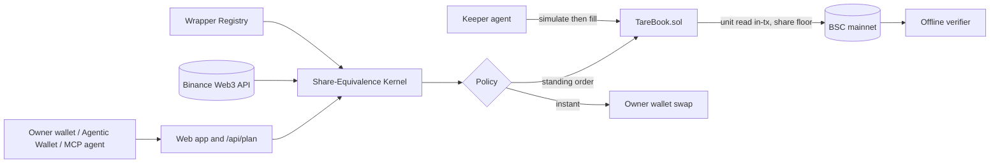

<p align="center">
  
</p>

<h1 align="center">Tare</h1>

<p align="center">
  <a href="{{origin}}"></a>
  <a href="https://bscscan.com/address/{{book}}"></a>
  <a href="{{origin}}/api/agent/keeper"></a>
  
  
  
</p>

**Tare lets first-time on-chain investors set a standing order for a US stock once, in real shares, and have it filled at any hour of the week without handing over their keys, because the chain itself refuses any fill that gives them fewer shares than they signed for.**

<p align="center"></p>

Amara saves in USDT and wants a little Nvidia every month. On BNB Chain she finds three tokens called Nvidia, each priced in a different unit, and a market that has been shut since Friday night. Tare weighs the three in real shares, takes her limit once, and lets an agent fill it at any hour from the wrapper that delivers the most shares. The contract reads the issuer's unit in the same transaction and reverts if the shares fall short.

## Links

| What | Where |
|---|---|
| Live app | {{origin}} |
| Judge path (about two minutes, no wallet) | {{origin}}/judge |
| Proof | {{origin}}/proof |
| Keeper status | {{origin}}/api/agent/keeper |
| TareBook (verified) | [{{book}}](https://bscscan.com/address/{{book}}#code) |
| WrapperRegistry (verified) | [{{registry}}](https://bscscan.com/address/{{registry}}#code) |
| Agentic Wallet skill | [`skills/tare/SKILL.md`](skills/tare/SKILL.md) |
| MCP endpoint | {{origin}}/api/mcp |
| A2A agent card | {{origin}}/.well-known/agent-card.json |
| Discovery | [`DISCOVERY.md`](DISCOVERY.md) |
| Developer experience log | [`docs/DX_LOG.md`](docs/DX_LOG.md) |

## The problem

Tokenized stocks trade all week on BNB Chain, but a buyer meets four traps.

1. **One ticker, three units.** Every ticker has a bStocks, an Ondo and an xStocks token. One token is {{units.maxUnitPct}} percent more than a share at most today, and two tokens of the same ticker differ by up to {{units.maxOndoVsBstocksBps}} bps from unit alone, before any premium exists.
2. **The reference is not a second opinion.** {{reference.bstocksWithoutStockPrice}} of {{reference.bstocksTotal}} bStocks have no equity reference in the public response, and for Ondo the derived reference is the same feed times the unit.
3. **The clock stops.** New York is closed {{weekendSharePct}} percent of the week. Tokens keep trading against a reference that is hours or days old.
4. **Quotes break.** {{brokenTotal}} of {{brokenObservations}} recorded quotes were more than five percent from the equity reference.

## The solution

A standing order in shares. The owner signs once: how many dollars, and the fewest shares acceptable. Any keeper may fill it. `TareBook` pulls USDT only at fill, executes an allowlisted route, reads the unit from the issuer in the same transaction, checks the shares and pays the owner. Anything below the floor reverts.

## Explore in two minutes

1. Open [`/judge`]({{origin}}/judge): a live shelf, then the retained mainnet records, each with a BscScan link.
2. Open [`/app/t/NVDA`]({{origin}}/app/t/NVDA): the three wrappers weighed in shares, the session, the chart.
3. Open [`/proof`]({{origin}}/proof): every claim, the command that reproduces it, and what it does not show.
4. Open [`/verify`]({{origin}}/verify) and enter an order id from the judge page.
5. From a terminal:

```bash
curl -s {{origin}}/api/agent/keeper | jq '{mode, passes, fills, refusalsByReason}'
curl -s {{origin}}/api/mcp -H 'content-type: application/json' -d '{"jsonrpc":"2.0","id":1,"method":"tools/list"}' | jq '.result.tools[].name'
```

## What was discovered

Short version of [`DISCOVERY.md`](DISCOVERY.md), regenerated from files:

- All {{discovery.tickers}} measured tickers have three wrappers on BSC ({{discovery.wrappers}} in total). The unit lives in the token for bStocks (`uiMultiplier`), in a separate oracle for Ondo (`getSValue`), and in a rebasing balance for xStocks.
- The public catalogue serves three provider types on BSC; the skill file documents only one.
- The API multiplier for xStocks differs from the token on {{apiVsChain.xstocksMismatch}} of {{apiVsChain.xstocksTotal}}.
- Median deepest pool: bStocks {{liquidity.BSTOCKS.medianDeepestPoolUsd}} USD, Ondo {{liquidity.ONDO.medianDeepestPoolUsd}} USD, xStocks {{liquidity.XSTOCKS.medianDeepestPoolUsd}} USD.
- With a contract as taker the aggregator returns executable SWAP calldata for bStocks and for Ondo wrappers, although its documentation calls Ondo RFQ only.

## Architecture

See [`ARCHITECTURE.md`](ARCHITECTURE.md).



## One fill

```
 quote ──> kernel ──> simulate ──> fill ──> unit read ──> share floor ──> receipt
```

## The guarantee

**Wrappers quote. Shares decide.** Twelve named invariants, each checked twice, in [`INVARIANTS.md`](INVARIANTS.md).

| ID | Invariant | Test |
|---|---|---|
| T2 | A buy never delivers fewer shares than signed | `test_shareFloorRevert` |
| T2b | A sell never pays less than the signed USDT per share | `test_sellFloorRevert` |
| T3 | The unit is read on-chain in the fill transaction | `test_keeperCannotPassUnit` |
| T4 | No fill while the issuer has paused the token | `test_corporatePause*` |
| T6 | The book holds nothing between transactions | `testFuzz_noResidual` |
| T7 | Output reaches the owner only | `test_maliciousRecipient` |
| T8 | An order fills at most once | `test_replay` |

## The numbers

Generated from `data/**/summary.json` by `scripts/render_docs.ts`.

### Autonomy, on BSC mainnet

| | |
|---|---|
| Orders placed (two buys, one sell) | {{autonomy.ordersPlaced}} |
| Fills made by the keeper | {{autonomy.fills}} |
| Fills with no owner transaction in between | {{autonomy.ownerOfflineFills}} |
| Fills while New York was closed | {{autonomy.fillsWhileNewYorkClosed}} |
| Seconds from placing to the first fill | {{autonomy.firstFillSecondsAfterPlacing}} |
| Distinct refusals logged by the keeper | {{autonomy.refusalsLogged}} |

### Counterfactual: shares per $50

| Arm | Mean shares | Median shares |
|---|---:|---:|
| Naive (lowest token price) | {{counter.arms.naive.meanShares}} | {{counter.arms.naive.medianShares}} |
| Random wrapper (control) | {{counter.arms.random.meanShares}} | {{counter.arms.random.medianShares}} |
| Tare (most shares) | {{counter.arms.tare.meanShares}} | {{counter.arms.tare.medianShares}} |

Tare minus random: {{counter.tareMinusRandomBps}} bps. Tare minus naive on direct pools: {{counter.tareMinusNaiveBps}} bps. With the aggregator, the two picks differ in {{agg.differs}} of {{agg.groups}} ticker-size groups, by {{agg.meanTareOverNaiveBps}} bps on average and {{agg.maxTareOverNaiveBps}} bps at most. The pick matters less than the guarantee, and the files say so.

### Break suite and tests

| Suite | Result |
|---|---|
| Contracts on a BSC mainnet fork | {{forge.passed}} passed, {{forge.failed}} failed |
| Kernel, registry, client, verifier, keeper | {{unitTests}} passed |

## How the Binance Web3 API is used

| Module | Use in Tare |
|---|---|
| RWA Data | Catalogue by provider type, per-token price, multiplier, equity reference and status, market session |
| Market | Hourly and daily candles for the weighing chart and the weekend calibration |
| Trading | Aggregated quotes and swap calldata with the book as taker (E6) |
| Transaction | Simulation before send (the keeper falls back to `eth_call` and records which it used) |
| Wallet | Holdings in shares |
| B402 | The paid certificate endpoint; needs a B402-enabled key |

The combination that looks like it should not work but does: the RWA reference, the on-chain unit factor, a Trading API quote and a simulation, ranked in shares.

## Agentic Wallet and BNB Agent Studio

| Item | State |
|---|---|
| Wallet Skills installed, skill written | Done: [`skills/tare/SKILL.md`](skills/tare/SKILL.md) |
| Agentic Wallet mainnet run | See [`docs/spikes/agentic-wallet.md`](docs/spikes/agentic-wallet.md) |
| ERC-8004 identity | Agent #{{agentId}} on BSC mainnet |
| ERC-8183 certificate job | Job {{job.jobId}}, state {{job.status}}, settles after the dispute window |
| Self-funding via B402 | Endpoint implemented; paid settlement needs a B402-enabled key |

## What is real and what is not

| Thing | Status |
|---|---|
| Contracts on BSC mainnet, verified | Real |
| Keeper fills, refusals, cancel on mainnet | Real, cents in size |
| Verifier PASS on the filled orders | Real, outputs in `evidence/mainnet` |
| Keeper hosted on a worker | Not yet: ran on the author machine |
| Agentic Wallet mainnet run | Needs the owner's app confirmation |
| Paid certificate settlement | Needs a B402-enabled key |
| ERC-8183 completion | Needs the seven day dispute window |

Full list in [`LIMITATIONS.md`](LIMITATIONS.md).

## Developer experience report

[`docs/DX_LOG.md`](docs/DX_LOG.md) is the raw log. `DX_REPORT.md` is written by the author from it.

## Run it

```bash
pnpm install
pnpm -r test
cd contracts && forge test -vvv          # needs BSC_RPC_URL; an archive RPC is better for long runs
cd .. && pnpm --filter @tare/web dev
npx tsx scripts/run_keeper.ts            # keeper and recorder, reads .env.local
pnpm discover                            # regenerate the discovery data
```

Environment variables are listed in `.env.example`.

## Repository map

```
contracts/    TareBook, WrapperRegistry, fork break suite, deploy script
packages/     kernel, registry, binance, verify
services/     keeper, agent
apps/web/     Next.js app, API routes, MCP, A2A, x402 endpoint
skills/tare/  Agentic Wallet skill
scripts/      discovery, counterfactual, calibration, autonomy, manifest, claims
data/         generated evidence (each file states source and range)
evidence/     fork logs and mainnet records
docs/         DX log, vendor documentation snapshots, spikes, claims ledger
```

## Roadmap

Hosted keeper worker, B402-enabled paid certificates, more issuer wrappers as pools deepen, notification delivery by more channels, a per-order tolerance written on-chain.

## Security

See [`SECURITY.md`](SECURITY.md).

## License and attribution

MIT. Fonts: Clash Display, General Sans and Gambetta by Fontshare (Indian Type Foundry, Fontshare Free Font License); JetBrains Mono (OFL). Photograph on the landing page: Namnso Ukpanah, Unsplash. Libraries: viem, wagmi, RainbowKit, Next.js, Tailwind CSS, framer-motion, lightweight-charts (Apache 2.0), OpenZeppelin Contracts, Foundry.

Built by 0xkinno.
